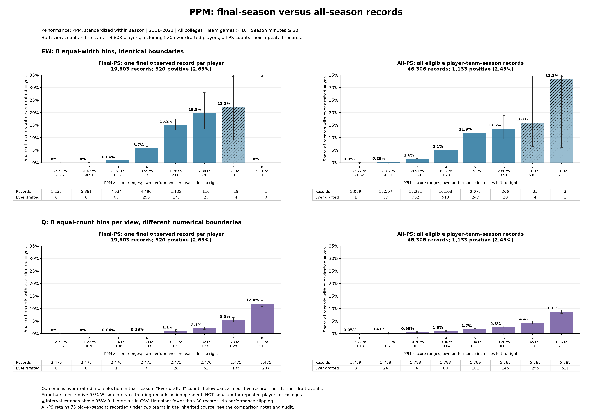

# Jazz night, comparison 03: PPM, all-PS alongside final-PS

**27 October 2026. Purpose:** Charles asked whether the empirical own-performance/draft relationship changes when we include all eligible season records instead of one final observed record per player. This is one controlled comparison, not a new parameter sweep. The previous eight-bin final-PS plots remain our saved baseline in `../02_eight_bin_comparison/`.

## Where we are in the story

We are still at the first empirical plot: own performance versus the proportion associated with eventual draft selection. No congestion measure, threshold, performance band, selection temperature, model fit, or significance test is involved. We have not changed the manuscript or the analysis notebooks.

The sequence so far was the first BPM plot with 12 bins, then eight bins, then PPM with eight bins, then a clearer 0–35% display scale. This comparison changes only which season records contribute, while retaining PPM and the eight-bin rules. It does not replace those earlier products or decide which view should enter the manuscript.

## Read the comparison

Larger views for inspecting counts:

- [Equal-width comparison](PPM_EW8_final_vs_all_PS.png): identical numerical performance boundaries on both sides.
- [Quantile comparison](PPM_Q8_final_vs_all_PS.png): eight nearly equal-count bins within each view, so numerical boundaries differ between views.

The left column reproduces the earlier final-PS rates and counts exactly. The right column includes every eligible record in the inherited all-PS snapshot. All panels use the same 0–35% vertical scale. Upward triangles identify confidence intervals extending above the display; their complete values are retained in `bin_counts.csv`.

## What stayed fixed

We use 2011–2021, all colleges, the existing MG10 filter (more than 10 distinct team-season games), and at least 20 total recorded season minutes. The minutes rule is not 20 minutes per game. Points per minute (PPM) is standardized within each season using the eligible full roster mean and sample standard deviation. Both views use exactly the same standardized performance value for any record they share. There is no performance clipping or additional minutes restriction.

The outcome remains the inherited **ever-drafted** indicator. It is not a measure of whether the player was drafted in that particular season. Quantile ties are split in fixed source order without consulting the outcome, consistent with the preceding figures.

## What changed, and what the counts mean

**Final-PS:** 19,803 records, one per player, including 520 ever-drafted players. The overall rate is 2.63%. Final means the last eligible observed season in the source window; a 2021 record is not necessarily the end of that player's college career. The existing source chooses a single record when a player's latest season has multiple team records; this comparison preserves that choice.

**All-PS:** 46,306 player–team–season records for the same 19,803 unique players. Of these records, 1,133 belong to the same 520 ever-drafted players. The overall record-weighted rate is 2.45%. There are not 1,133 distinct drafted players or draft selections.

For example, a player with three eligible seasons and an ever-drafted label contributes three positive records to all-PS, potentially at three different PPM levels, but contributes only one record to final-PS. Players with more eligible records receive more weight in all-PS. The two plots therefore answer related but different descriptive questions: the relationship at the last observed record, and the relationship across all observed records. Neither view estimates a same-season draft hazard.

The inherited all-PS file contains 46,233 distinct player-season combinations. Seventy-three player-seasons, involving 71 players, have records under two different teams, giving 46,306 records in total. All athlete/team/season keys are unique. These records are retained to preserve the existing data and filters; this is not evidence that they represent genuine transfers. They are listed in `multi_team_player_seasons_audit.csv` for a later source audit if needed. No unrequested merging or removal was performed.

## What we see

Both quantile curves rise with performance. In the highest quantile bin, final-PS has 297 positive records out of 2,475 (12.0%), compared with 511 out of 5,788 (8.83%) for all-PS. The lower edge of that bin changes from about 1.28 to 1.16 standardized PPM, so this contrast includes a change in numerical bin boundaries as well as the change in records.

The equal-width bins avoid that boundary change. In bin 5, for example, the same approximately 1.70–2.80 standardized PPM range has 170 of 1,122 positive records (15.15%) in final-PS versus 247 of 2,072 (11.92%) in all-PS. Several lower bins have higher rates in all-PS, while populated higher bins have lower rates. This is consistent with earlier-season records redistributing ever-drafted labels across performance levels; the comparison does not isolate a causal explanation.

The extreme right-hand equal-width bin changes from zero of one record to one of three records (33.3%). Its apparent jump rests on only three records. It does not establish a reliable tail pattern. Counts remain essential when reading these plots.

## Uncertainty and limits

For continuity, both views retain the earlier pointwise 95% Wilson intervals. These intervals use a binomial approximation that treats records as independent. All-PS repeats people and their outcome labels, and neither view adjusts for college grouping. The displayed intervals therefore are descriptive approximations, not a basis for claiming a statistically significant difference between these views. Final-PS is contained within all-PS; the two samples are not independent either. No significance test has been performed.

## Saved and checked

This folder contains the two side-by-side figures, the four-panel mosaic, complete bin counts, record memberships and bin assignments for each view, season totals, quantile tie records, the multiple-team audit, source fingerprints, a reproducible build script, and validation results. Validation confirms that the prior final-PS counts/rates/intervals are reproduced, both views contain the same unique players, every record is counted once per binning, and equal-width boundaries match exactly.

**Return point:** Keep the previous final-PS plot as the baseline and this folder as the documented all-PS comparison. We have not yet chosen between them for the manuscript. The next discussion is which observational unit best supports the question we want that first empirical plot to answer.
