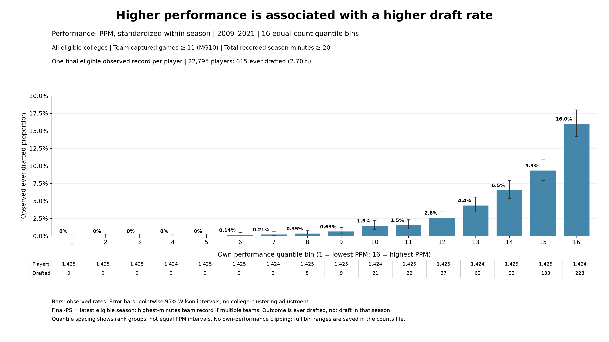
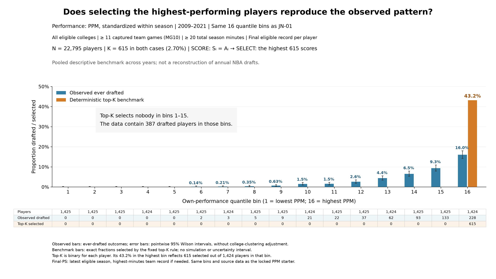
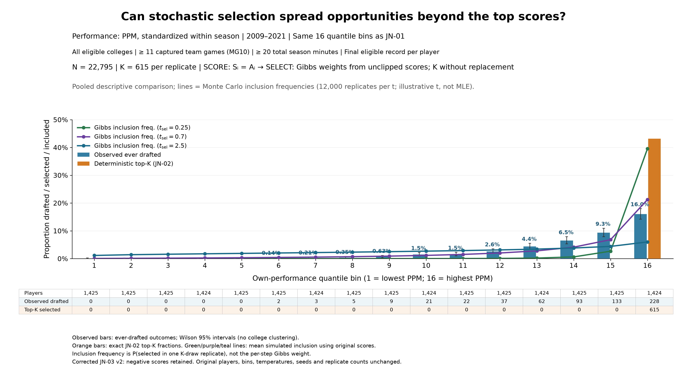

# JN progression: the manuscript story, one figure at a time

**Last synced:** 27 October 2026  
**Purpose:** This is the standalone outline, with figures, around which Charles and his collaborator will rebuild or edit the manuscript.  
**Current step:** Step 3 — corrected JN-03 version 2 uses the original, unclipped PPM scores. Ready for review, not locked. JN-01 and JN-02 remain LOCKED. The clipping correction and before/after plots are recorded in walkthrough Section 14. No temperature fit has been run.

## How we will use this document

We will develop the argument one step at a time: show the observation, propose the simplest explanation, compare it with the data, and add an ingredient only when the comparison identifies something it does not explain. Each completed step will contain its figure, the message it supports, proposed manuscript wording, and the transition to the next step.

A figure is **ready for review** when its data and presentation have been checked. We mark it **LOCKED** when Charles accepts it for the progression, recording its version, population, outcome, bins, scale, and intended claim. A later change is possible, but we record why and revise the relevant comparisons together. “Locked” means an agreed working figure, not a prohibition on improving the final manuscript.

The [experimental walkthrough](Jazz_Night_Experimental_Walkthrough.md) records how we explored alternatives. This progression records what we intend to use and how the scientific argument develops. It can be read on its own; the older experiments are not prerequisites for following the story.

## Step 1. Establish the observed relationship between performance and selection

**Status:** Figure JN-01, version 1 — **LOCKED by Charles on 27 October 2026.** Original canonical data reproduced exactly; accepted 0–20% display preserved.

### The point we want the reader to see

Players with higher measured performance are more likely to be drafted. The observed draft rate rises sharply among the highest-performing players. This gives us an empirical relationship for the model to explain.

### The figure

**Figure JN-01.** Observed ever-drafted proportion across 16 quantile bins of own performance, measured by PPM standardized within season. NCAA basketball, 2009–2021; all eligible colleges; one final eligible observed record per player. Bars reproduce the historical canonical naïve plot. Error bars are pointwise 95% Wilson intervals, without college-clustering adjustment; player and draft counts appear below the bars.

### What is fixed in the locked version

- **Population:** 22,795 players; 615 ever drafted. Team-seasons require at least 11 captured games (MG10), and player/team/season records require at least 20 total recorded minutes.
- **Performance:** Points per minute (PPM), standardized using the eligible full roster within each season. No own-performance clipping.
- **Focal record:** Latest eligible observed season after filtering; highest-total-minutes team record when that season has multiple teams. This is not necessarily the last season of a completed college career.
- **Outcome:** Ever drafted, not selected during that particular season. The overall 2.70% is a pooled fraction, not automatically an annual draft quota.
- **Binning and display:** Sixteen nearly equal-count quantile bins, ordered from low to high PPM; fixed source-order allocation of tied values; 0–20% vertical range. Quantile positions are rank groups, not equally spaced numerical PPM values.

Every bin’s count and rate, and its mean and median performance, match the original saved canonical data. The highest bin contains **228 drafted players out of 1,424, or 16.0%**. We describe the sharp upward pattern without claiming to have fitted an exponential relationship.

### Proposed manuscript text

Players with higher measured performance are more likely to be drafted. Figure JN-01 shows this relationship using points per minute, standardized within season. Draft rates are close to zero among the lowest-performing groups and rise sharply toward the upper end of the distribution. We begin by asking how much of this relationship can be explained by selection based solely on individual performance.

### Transition to Step 2

**What would selection look like if candidates were ranked strictly by their measured performance and the highest-ranked candidates received the available opportunities?**

### Lock record

**Acceptance:** Charles accepted this opening figure on 27 October 2026 (“YES”) and requested an equal-width companion. The lock applies to JN-01 version 1; the new EW companion has not yet been accepted.  
**Plot:** `04_canonical_naive/canonical_naive_PPM_Q16_2009_2021.png`  
**Scalable version:** `04_canonical_naive/canonical_naive_PPM_Q16_2009_2021.svg`  
**Evidence:** Exact bin counts, player membership, source fingerprints and validation are saved alongside the figure.  
**Next action:** Review the EW companion below; then continue to Step 2. Keep the locked Q16 opening figure unchanged unless Charles requests a revision.

### Early companion: what changes when the bins have equal width?

**Status:** Figure JN-01-EW, version 1 — ready for review, **not yet locked**. Same players and outcomes as JN-01; only the binning changes.

**Purpose in the story:** Explain the two ways of summarizing the observed relationship before using the plots to compare model predictions.

**Proposed accompanying text:** Quantile bins divide the population into groups containing approximately equal numbers of players, whereas equal-width bins divide the performance scale into equal intervals. The latter preserve a constant numerical performance width, but the number of players can vary greatly across intervals. In this sample, each quantile bin contains about 1,425 players, while the highest equal-width bins contain only a handful. Reading the counts alongside the rates shows how the same observations produce these different summaries.

**Useful example:** The final quantile bin contains 1,424 players across approximately 1.717–6.114 standardized PPM. The final EW bin covers only 5.562–6.114 and contains one player. The identically numbered bins are different groups. EW bin 14 contains two drafted players out of five (40%); bin 15 is empty, so no rate is estimated there.

**Display:** This companion uses a 0–50% y-axis to show the 40% observed rate. Hatching identifies fewer than 30 players; arrows mark confidence intervals extending beyond 50%. The [side-by-side Q/EW comparison](05_canonical_EW_companion/naive_PPM_Q16_vs_EW16_same_scale.png) puts both views on 0–50% for direct comparison. It does not alter the accepted standalone Q16 plot’s 0–20% scale.

**Evidence and lock record:** All 22,795 players and 615 drafted labels are accounted for, and Q assignments/counts reproduce the locked source. Exact EW edges, counts, memberships and validation are saved in `05_canonical_EW_companion/`. Charles’s acceptance of this companion is pending.

## Step 2. Test the performance-only deterministic benchmark

**Status:** Figure JN-02, version 1 — **LOCKED by Charles on 27 October 2026** (approved for the progression). PPM remains the working metric.

### The question

What would the observed relationship look like if measured performance alone determined who received the available opportunities?

### The benchmark we actually calculated

Use the same 22,795 players, 2009–2021 records, standardized PPM values and 16 quantile-bin memberships as JN-01. Treat this historical sample as **one pooled descriptive comparison**, with $K=615$ selections, matching the number of ever-drafted players in the sample. Thus $K/N=2.70\%$ describes this pooled allocation; it is not an annual NBA draft quota.

First, **SCORE** assigns $S_i=A_i$. Then **SELECT** ranks those scores and selects the highest 615. The observed outcome supplies the total number of selections, but never determines which players the benchmark selects. A fixed source-order rule would resolve exact performance ties; no tie occurs at the selection boundary in this calculation. No population was simulated and no parameter was fitted.

### The figure

**Figure JN-02.** Blue bars show observed ever-drafted proportions. Orange bars show the proportions selected by the pooled deterministic top-K benchmark. Both use the identical players and quantile bins, with 615 positive outcomes/selections in total. Only observed rates carry pointwise 95% Wilson intervals, without college-clustering adjustment. The deterministic benchmark is an exact calculation conditional on the declared scores and capacity.

### What the comparison shows

All 615 benchmark selections fall within the highest quantile bin, which contains 1,424 players. Its benchmark selected fraction is therefore **43.2%**, compared with **228 of 1,424 (16.0%) actually ever drafted**. The benchmark selects nobody from bins 1–15, whereas **387 actually drafted players occur in those bins**.

The benchmark assigns each individual a binary selection outcome. The orange bar’s 43.2% does not mean each player has a 43.2% chance: it is the fraction selected within a bin that straddles the deterministic cutoff. The PPM cutoff lies between standardized values 2.174506 and 2.174822, wholly inside bin 16.

This comparison uses a **0–50% vertical scale** to display both series fully. The observed blue bar values and counts are unchanged from JN-01. Its accepted standalone 0–20% figure remains intact.

### Proposed manuscript text

Strict ranking by measured performance concentrates selection more strongly at the upper end than the observed outcomes do. Selecting the 615 highest-scoring players in this pooled sample places every selection in the highest performance bin. In contrast, only 228 of the 615 observed drafted players fall in that bin; the other 387 are distributed across lower-performance bins. Thus, although higher PPM is associated with a higher draft rate, this pooled performance-only deterministic benchmark does not reproduce the observed distribution of drafted players.

### What this establishes, and the transition

The demonstrated failure belongs to **this score and this pooled selection rule**. It does not establish that real decisions are intrinsically random, or rule out deterministic models with additional information or different annual candidate pools. Unmeasured player characteristics, imperfect performance measurement and differences between actual selection pools can also contribute to the mismatch.

The next model step is to allow uncertainty in **SELECT** while keeping **SCORE** at $S_i=A_i$: higher-scoring players can be favored without requiring that every selection come from the highest scores. We will compare that rule against these same observed bars. This figure motivates the comparison; it does not yet show that the stochastic rule fits adequately.

### Evidence and review record

[The JN-02 folder](07_JN02_deterministic_topK/README.md) contains the PNG and scalable SVG, exact observed/benchmark bin counts, player-level membership and selection indicators, source fingerprints, boundary diagnostics and validation. The population, observed outcomes and bins reproduce JN-01 exactly.

**Lock record:** Charles accepted JN-02 for the progression on 27 October 2026.

## Step 3. Introduce uncertainty in selection

**Status:** Figure JN-03, **corrected version 2 — ready for review, not locked**. Rebuilt 27 October 2026 with original, unclipped scores. The superseded implementation and correction are documented in [walkthrough Section 14](Jazz_Night_Experimental_Walkthrough.md#14-we-introduced-stochastic-selection-then-corrected-a-score-clipping-mistake).

**Purpose:** Address the Step 2 mismatch by allowing higher scores to increase the chance of selection without guaranteeing that every winner comes from the top of the list. Keep **SCORE** at $S_i=A_i$, including negative standardized PPM values. **SELECT** assigns positive weights $e^{S_i/t_{\mathrm{sel}}}$ and samples $K=615$ distinct candidates without replacement from the same 22,795-player pool.

### The figure

**Figure JN-03, corrected v2.** Blue bars: observed ever-drafted rates (JN-01). Orange bars: deterministic top-K fractions (JN-02). Colored lines: Monte Carlo estimates of final inclusion probabilities at illustrative temperatures 0.25, 0.7 and 2.5. Each temperature uses 12,000 repetitions, each selecting exactly 615 distinct players. Population, source records, bins, temperatures, seeds, replication counts and 0–50% scale are unchanged from version 1. Only the unintended zero-clipping of scores was removed.

### What the corrected comparison shows

At temperature 0.25, the highest bin has an estimated inclusion rate of **39.54%**, still close to the deterministic 43.19%. At temperature 0.7, its rate is **21.24%**, while bin 15 receives **6.82%** and bin 1 receives **0.056%**. Increasing temperature to 2.5 reduces the highest-bin rate to **6.00%** and raises the lowest-bin rate to **1.14%**. The finite-temperature curves still favor higher scores; equal inclusion at $K/N\approx2.70\%$ is the infinite-temperature limit, not a claim that temperature 2.5 has already reached it.

The lines estimate final inclusion across complete selections of 615 players. They are not the per-draw probabilities or the exponential weights themselves. None of these temperatures has been fitted. In particular, the corrected temperature-0.7 curve still differs from the observed 16.0% highest-bin rate and the shape in the other bins.

### Proposed manuscript text

Allowing uncertainty in selection distributes opportunities beyond the highest-scoring candidates while preserving an advantage for stronger performance. With the scores fixed, increasing selection temperature reduces the concentration of selections in the highest performance bin and increases inclusion at lower scores. The illustrative curves show how this mechanism changes the predicted relationship; they do not establish which temperature, if any, adequately describes the observed outcomes. That requires a likelihood consistent with the selection rule and the observations.

### Correction record

Version 1 inadvertently used a legacy routine that changed negative scores to zero before calculating Gibbs weights. It therefore simulated weights proportional to $e^{\max(S_i,0)/t_{\mathrm{sel}}}$ rather than the intended $e^{S_i/t_{\mathrm{sel}}}$. Version 2 preserves the original scores. The correction is local to JN-03; other project simulations and the shared legacy routine were not changed. The walkthrough contains both plots and the full explanation, so this progression can remain focused on the corrected model story.

### Transition to Step 4

**How much selection uncertainty is consistent with the observed outcomes when $S_i=A_i$?** Estimate temperature using a likelihood that matches the defined pool and the observed unordered selection outcomes, rather than choosing it by visual fit alone. This remains a pooled descriptive comparison; annual NBA draft pools have not been reconstructed.

### Evidence and review record

[The current JN-03 folder](08_JN03_stochastic_gibbs/README.md) holds the corrected figure, all nine temperature results, player inclusion estimates, before/after bin comparisons, source fingerprints and validation. Every repetition was checked for exactly 615 distinct selections; original scores, identities, outcomes and bins match version 1. Negative-score weight ordering and common-score-shift invariance were also checked. **Next action: Charles reviews corrected JN-03 before lock. Step 4 fitting has not begun.**

## Step 4. Estimate the performance-only selection temperature

**Status:** Proposed story step; no fit has been run or locked for this progression.

**Purpose:** Estimate temperature rather than choose it solely because its curve looks appealing. Use a likelihood consistent with the candidate pools, outcome timing, and selection process defined earlier.

**Figure to build:** The observed own-performance relationship and the fitted performance-only prediction, with a clear account of its fit and remaining discrepancies. An unordered set of winners and an ordered sequence require different likelihood treatment; independent Bernoulli rows are not automatically the exact-$K$ likelihood.

**What this establishes:** A performance-only baseline against which to judge the later group-dependent model. Its temperature may absorb omitted group effects, so it can be re-estimated when the score is extended.

**Transition:** Does a model that describes the relationship with own performance also explain how outcomes vary with the group environment?

## Step 5. Introduce groups, identify the missing pattern, and develop congestion

**Status:** Proposed story sequence; empirical figures, congestion definition, and model comparisons not yet selected or locked here.

### 5A. Show the group-related empirical question

Introduce the empirical HERO and band-of-excellence comparisons: among individuals with comparable own performance, how does selection vary with the composition of their group? Define the focal bands, environmental axis, and outcome when choosing the figures. Project the performance-only model onto those same axes to determine what it already explains.

**Figure to build or recover:** Observed and baseline-predicted rates against the declared group measure, with comparable performance bands on common axes. The purpose is to demonstrate a specific mismatch, not to assume that every group-axis curve must turn down.

### 5B. Add a simple congestion term to SCORE

If the preceding comparison identifies a group-related discrepancy, introduce $S_i=A_i-\lambda C_i$ using a clearly declared congestion measure. Group mean performance is one possible first specification. Assess what improves and what remains missing before adding another parameter or changing the measure.

**Figure to build:** The previous model and the congestion model against the same empirical target. Keep the empirical plotting axis distinct from the congestion term used in the score.

### 5C. Introduce competitive relevance when the simpler measure is insufficient

If mean performance fails to capture an important difference between groups, ask which peers are plausible competitors. Introduce the competitive-relevance threshold and the sigmoid’s sharpness, then aggregate those values into roster pressure. Shared and leave-one-out versions remain choices to evaluate; this progression has not selected one.

Scarcity $K/N$ was introduced with the allocation problem in Step 2. Revisit it here to consider whether it should inform the threshold. That link is a model specification to examine. The sigmoid changes the systematic congestion measure; it does not itself add randomness to SELECT.

**Figure to build:** A comparison showing the limitation of the simpler measure and whether competitive relevance addresses it. Parameter-family curves can then show how a supported interior peak’s location and curvature change, following Alex’s guidance.

## Later sections to outline together

The detailed parameter exploration, analytical development, assignment mechanism, and complete fitting argument are still to be placed and developed. This document carries forward the agreed opening outline without inventing completed evidence or locking later sections prematurely. Most existing manuscript material may remain useful; the progression will determine its placement and the comparisons that must accompany it.

## Visual continuity as the story develops

Use a common title/metadata structure, observed-data color, percentage labeling, count strip, and readable typography. The current figure’s settings are stored separately from its verified data so that display changes can be made consistently.

Keep bins and scales the same when the reader is making a direct comparison. If a model prediction or a later empirical range requires a larger y-axis, show it fully and revise the paired figures together. The present 0–20% scale is not a promise that all future figures will fit within it. A change in cohort or binning is an analytical change and must be recorded separately from a visual adjustment.

For now, prioritize plots that make the scientific point clear. Before final manuscript assembly, review the whole accepted sequence for consistent axes, bins, terminology and captions. Charles’s approval of a figure will be recorded here, one step at a time.

## Progress record

**27 October 2026:** Charles selected the historical canonical naïve plot as the starting point to reproduce, and requested this standalone progression with figures that can be reviewed and locked. JN-01 version 1 reproduces all 16 canonical data bins in the new visual format. At that point its presentation was ready for review; the subsequent acceptance is recorded below. The manuscript remains unchanged.

**27 October 2026 — first lock:** Charles accepted JN-01 version 1 and requested an EW companion. JN-01 is now LOCKED. The EW16 companion uses the identical population and outcomes and is ready for review; an additional common-scale Q/EW display supports the early binning discussion. No source data or accepted Q16 image was changed.

**27 October 2026 — JN-02 built:** Charles chose to continue with PPM and authorized the pooled deterministic top-K comparison. JN-02 is ready for review, not locked. The same 615 total selections are concentrated entirely in bin 16 under top-K; the data contain 228 drafted players there and 387 below. The expanded 0–50% comparison scale leaves JN-01 unchanged. BPM remains a walkthrough-only experiment. No stochastic model or fit was run.

**27 October 2026 — JN-02 locked; JN-03 built:** Charles accepted JN-02 for the progression. JN-03 adds Gibbs rule D inclusion frequencies (illustrative $t_{\mathrm{sel}}$) on the same cohort and bins. Ready for review; no MLE.

**27 October 2026 — JN-03 corrected to version 2:** Charles authorized removal of unintended zero-clipping of scores. All nine temperatures were rerun with the same cohort, bins, K, repetition counts and seeds. Version 1 is clearly marked superseded and preserved; the walkthrough shows both plots and explains the changes. JN-03 v2 is ready for review, not locked. No fit was run.

**27 October 2026 — manuscript housekeeping:** This progression and all Jazz Night figures now live in `new_VECTOR_work/jazz_night`. Current scientific content, results and lock decisions are unchanged. The [walkthrough](Jazz_Night_Experimental_Walkthrough.md) records the move in Section 15.
