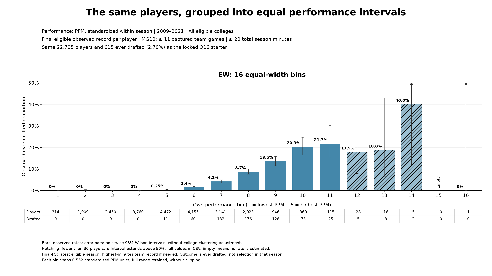

# JN progression: the manuscript story, one figure at a time

**Last synced:** 27 October 2026  
**Purpose:** This is the standalone outline, with figures, around which Charles and his collaborator will rebuild or edit the manuscript.  
**Current step:** Step 1 — JN-01 (quantile starter) is LOCKED. Review the new equal-width companion for an early discussion of binning. Subsequent steps remain proposed; no model comparison or fit below has yet been completed for this progression.

## How we will use this document

We will develop the argument one step at a time: show the observation, propose the simplest explanation, compare it with the data, and add an ingredient only when the comparison identifies something it does not explain. Each completed step will contain its figure, the message it supports, proposed manuscript wording, and the transition to the next step.

A figure is **ready for review** when its data and presentation have been checked. We mark it **LOCKED** when Charles accepts it for the progression, recording its version, population, outcome, bins, scale, and intended claim. A later change is possible, but we record why and revise the relevant comparisons together. “Locked” means an agreed working figure, not a prohibition on improving the final manuscript.

The [experimental walkthrough](Jazz_Night_Experimental_Walkthrough.md) records how we explored alternatives. This progression records what we intend to use and how the scientific argument develops. It can be read on its own; the older experiments are not prerequisites for following the story.

## Step 1. Establish the observed relationship between performance and selection

**Status:** Figure JN-01, version 1 — **LOCKED by Charles on 27 October 2026.** Original canonical data reproduced exactly; accepted 0–20% display preserved.

### The point we want the reader to see

Players with higher measured performance are more likely to be drafted. The observed draft rate rises sharply among the highest-performing players. This gives us an empirical relationship for the model to explain.

### The figure

**Figure JN-01.** Observed ever-drafted proportion across 16 quantile bins of own performance, measured by PPM standardized within season. NCAA basketball, 2009–2021; all eligible colleges; one final eligible observed record per player. Bars reproduce the historical canonical naïve plot. Error bars are pointwise 95% Wilson intervals, without college-clustering adjustment; player and draft counts appear below the bars.

### What is fixed in the locked version

- **Population:** 22,795 players; 615 ever drafted. Team-seasons require at least 11 captured games (MG10), and player/team/season records require at least 20 total recorded minutes.
- **Performance:** Points per minute (PPM), standardized using the eligible full roster within each season. No own-performance clipping.
- **Focal record:** Latest eligible observed season after filtering; highest-total-minutes team record when that season has multiple teams. This is not necessarily the last season of a completed college career.
- **Outcome:** Ever drafted, not selected during that particular season. The overall 2.70% is a pooled fraction, not automatically an annual draft quota.
- **Binning and display:** Sixteen nearly equal-count quantile bins, ordered from low to high PPM; fixed source-order allocation of tied values; 0–20% vertical range. Quantile positions are rank groups, not equally spaced numerical PPM values.

Every bin’s count and rate, and its mean and median performance, match the original saved canonical data. The highest bin contains **228 drafted players out of 1,424, or 16.0%**. We describe the sharp upward pattern without claiming to have fitted an exponential relationship.

### Proposed manuscript text

Players with higher measured performance are more likely to be drafted. Figure JN-01 shows this relationship using points per minute, standardized within season. Draft rates are close to zero among the lowest-performing groups and rise sharply toward the upper end of the distribution. We begin by asking how much of this relationship can be explained by selection based solely on individual performance.

### Transition to Step 2

**What would selection look like if candidates were ranked strictly by their measured performance and the highest-ranked candidates received the available opportunities?**

### Lock record

**Acceptance:** Charles accepted this opening figure on 27 October 2026 (“YES”) and requested an equal-width companion. The lock applies to JN-01 version 1; the new EW companion has not yet been accepted.  
**Plot:** `04_canonical_naive/canonical_naive_PPM_Q16_2009_2021.png`  
**Scalable version:** `04_canonical_naive/canonical_naive_PPM_Q16_2009_2021.svg`  
**Evidence:** Exact bin counts, player membership, source fingerprints and validation are saved alongside the figure.  
**Next action:** Review the EW companion below; then continue to Step 2. Keep the locked Q16 opening figure unchanged unless Charles requests a revision.

### Early companion: what changes when the bins have equal width?

**Status:** Figure JN-01-EW, version 1 — ready for review, **not yet locked**. Same players and outcomes as JN-01; only the binning changes.

**Purpose in the story:** Explain the two ways of summarizing the observed relationship before using the plots to compare model predictions.

**Proposed accompanying text:** Quantile bins divide the population into groups containing approximately equal numbers of players, whereas equal-width bins divide the performance scale into equal intervals. The latter preserve a constant numerical performance width, but the number of players can vary greatly across intervals. In this sample, each quantile bin contains about 1,425 players, while the highest equal-width bins contain only a handful. Reading the counts alongside the rates shows how the same observations produce these different summaries.

**Useful example:** The final quantile bin contains 1,424 players across approximately 1.717–6.114 standardized PPM. The final EW bin covers only 5.562–6.114 and contains one player. The identically numbered bins are different groups. EW bin 14 contains two drafted players out of five (40%); bin 15 is empty, so no rate is estimated there.

**Display:** This companion uses a 0–50% y-axis to show the 40% observed rate. Hatching identifies fewer than 30 players; arrows mark confidence intervals extending beyond 50%. The [side-by-side Q/EW comparison](05_canonical_EW_companion/naive_PPM_Q16_vs_EW16_same_scale.png) puts both views on 0–50% for direct comparison. It does not alter the accepted standalone Q16 plot’s 0–20% scale.

**Evidence and lock record:** All 22,795 players and 615 drafted labels are accounted for, and Q assignments/counts reproduce the locked source. Exact EW edges, counts, memberships and validation are saved in `05_canonical_EW_companion/`. Charles’s acceptance of this companion is pending.

## Step 2. Build the performance-only benchmark

**Status:** Proposed story step; figure not yet built or locked.

**Purpose:** Translate the intuition that better performers should be selected into a simple, explicit rule. Assign the score $S_i=A_i$, then rank candidates and select the top $K$. SCORE and SELECT are separate operations.

**Figure to build:** The observed relationship from Step 1 alongside the deterministic benchmark, summarized using the same declared bins and outcomes. Keep observed data visually consistent and distinguish the model prediction clearly.

**What we must specify before calculation:** Who competes in each selection pool, how the outcome is timed, and what $K$ represents. The Step 1 pooled ever-drafted fraction does not establish an annual draft quota. A descriptive pooled benchmark is possible if explicitly defined as such; it must not be presented as a reconstructed annual NBA draft process.

**Question for the comparison:** What does strict performance ranking reproduce, and what does it miss? The observed plot alone does not demonstrate the answer. In particular, combining selection pools with different deterministic thresholds can smooth the aggregate relationship.

**Transition if supported:** Higher performance favors selection, but strict performance ranking does not adequately describe the observed selections.

## Step 3. Introduce uncertainty in selection

**Status:** Proposed story step; figure not yet built or locked.

**Purpose:** Address a demonstrated mismatch in Step 2 by allowing higher scores to increase the chance of selection without guaranteeing the ordering of winners. Keep the performance-only score and introduce Gibbs-weighted selection without replacement. Selection temperature controls how strongly score differences matter.

**Figure to build:** Observed rates, the deterministic benchmark, and stochastic selection frequencies on the same axes and the same declared bins. We can repeatedly select from the observed candidates to estimate model inclusion frequencies; we do not need to invent a new player population for this first comparison.

**Question for the comparison:** Does the probabilistic rule better describe the observed relationship, and what remains unexplained? The exponential Gibbs weight is not itself the final probability of receiving one of $K$ places.

**Transition if supported:** Having introduced selection uncertainty, determine how much is supported by the observations.

## Step 4. Estimate the performance-only selection temperature

**Status:** Proposed story step; no fit has been run or locked for this progression.

**Purpose:** Estimate temperature rather than choose it solely because its curve looks appealing. Use a likelihood consistent with the candidate pools, outcome timing, and selection process defined earlier.

**Figure to build:** The observed own-performance relationship and the fitted performance-only prediction, with a clear account of its fit and remaining discrepancies. An unordered set of winners and an ordered sequence require different likelihood treatment; independent Bernoulli rows are not automatically the exact-$K$ likelihood.

**What this establishes:** A performance-only baseline against which to judge the later group-dependent model. Its temperature may absorb omitted group effects, so it can be re-estimated when the score is extended.

**Transition:** Does a model that describes the relationship with own performance also explain how outcomes vary with the group environment?

## Step 5. Introduce groups, identify the missing pattern, and develop congestion

**Status:** Proposed story sequence; empirical figures, congestion definition, and model comparisons not yet selected or locked here.

### 5A. Show the group-related empirical question

Introduce the empirical HERO and band-of-excellence comparisons: among individuals with comparable own performance, how does selection vary with the composition of their group? Define the focal bands, environmental axis, and outcome when choosing the figures. Project the performance-only model onto those same axes to determine what it already explains.

**Figure to build or recover:** Observed and baseline-predicted rates against the declared group measure, with comparable performance bands on common axes. The purpose is to demonstrate a specific mismatch, not to assume that every group-axis curve must turn down.

### 5B. Add a simple congestion term to SCORE

If the preceding comparison identifies a group-related discrepancy, introduce $S_i=A_i-\lambda C_i$ using a clearly declared congestion measure. Group mean performance is one possible first specification. Assess what improves and what remains missing before adding another parameter or changing the measure.

**Figure to build:** The previous model and the congestion model against the same empirical target. Keep the empirical plotting axis distinct from the congestion term used in the score.

### 5C. Introduce competitive relevance when the simpler measure is insufficient

If mean performance fails to capture an important difference between groups, ask which peers are plausible competitors. Introduce the competitive-relevance threshold and the sigmoid’s sharpness, then aggregate those values into roster pressure. Shared and leave-one-out versions remain choices to evaluate; this progression has not selected one.

Scarcity $K/N$ was introduced with the allocation problem in Step 2. Revisit it here to consider whether it should inform the threshold. That link is a model specification to examine. The sigmoid changes the systematic congestion measure; it does not itself add randomness to SELECT.

**Figure to build:** A comparison showing the limitation of the simpler measure and whether competitive relevance addresses it. Parameter-family curves can then show how a supported interior peak’s location and curvature change, following Alex’s guidance.

## Later sections to outline together

The detailed parameter exploration, analytical development, assignment mechanism, and complete fitting argument are still to be placed and developed. This document carries forward the agreed opening outline without inventing completed evidence or locking later sections prematurely. Most existing manuscript material may remain useful; the progression will determine its placement and the comparisons that must accompany it.

## Visual continuity as the story develops

Use a common title/metadata structure, observed-data color, percentage labeling, count strip, and readable typography. The current figure’s settings are stored separately from its verified data so that display changes can be made consistently.

Keep bins and scales the same when the reader is making a direct comparison. If a model prediction or a later empirical range requires a larger y-axis, show it fully and revise the paired figures together. The present 0–20% scale is not a promise that all future figures will fit within it. A change in cohort or binning is an analytical change and must be recorded separately from a visual adjustment.

For now, prioritize plots that make the scientific point clear. Before final manuscript assembly, review the whole accepted sequence for consistent axes, bins, terminology and captions. Charles’s approval of a figure will be recorded here, one step at a time.

## Progress record

**27 October 2026:** Charles selected the historical canonical naïve plot as the starting point to reproduce, and requested this standalone progression with figures that can be reviewed and locked. JN-01 version 1 reproduces all 16 canonical data bins in the new visual format. At that point its presentation was ready for review; the subsequent acceptance is recorded below. The manuscript remains unchanged.

**27 October 2026 — first lock:** Charles accepted JN-01 version 1 and requested an EW companion. JN-01 is now LOCKED. The EW16 companion uses the identical population and outcomes and is ready for review; an additional common-scale Q/EW display supports the early binning discussion. No source data or accepted Q16 image was changed.
